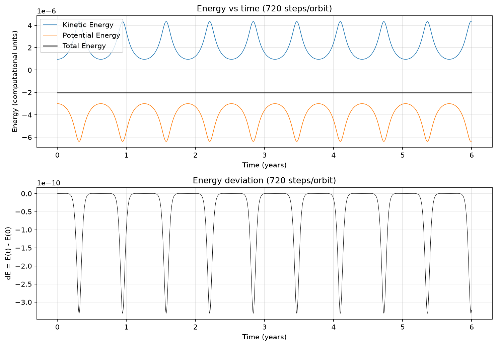
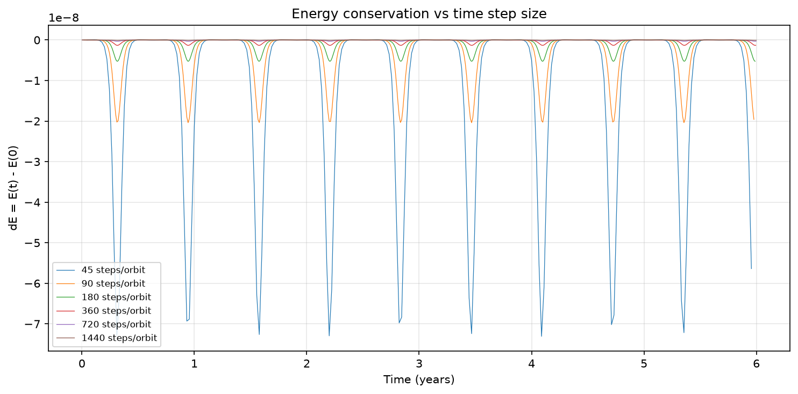
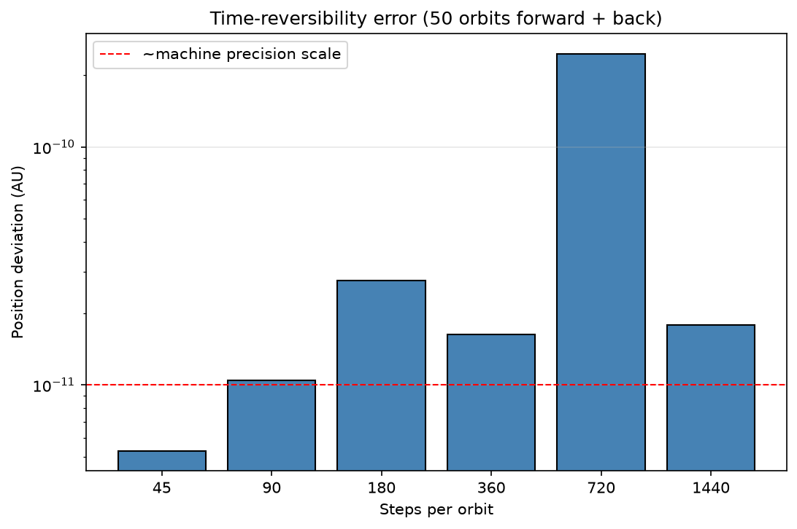
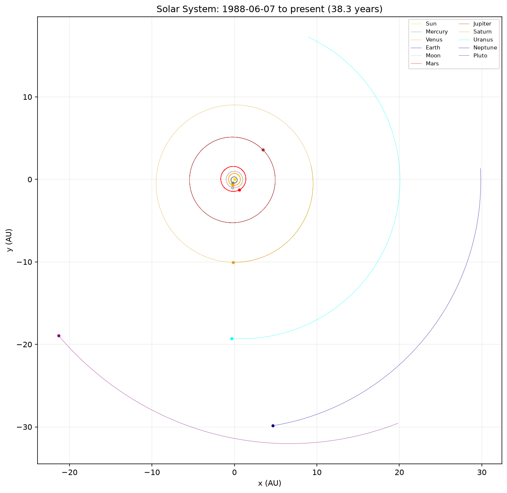
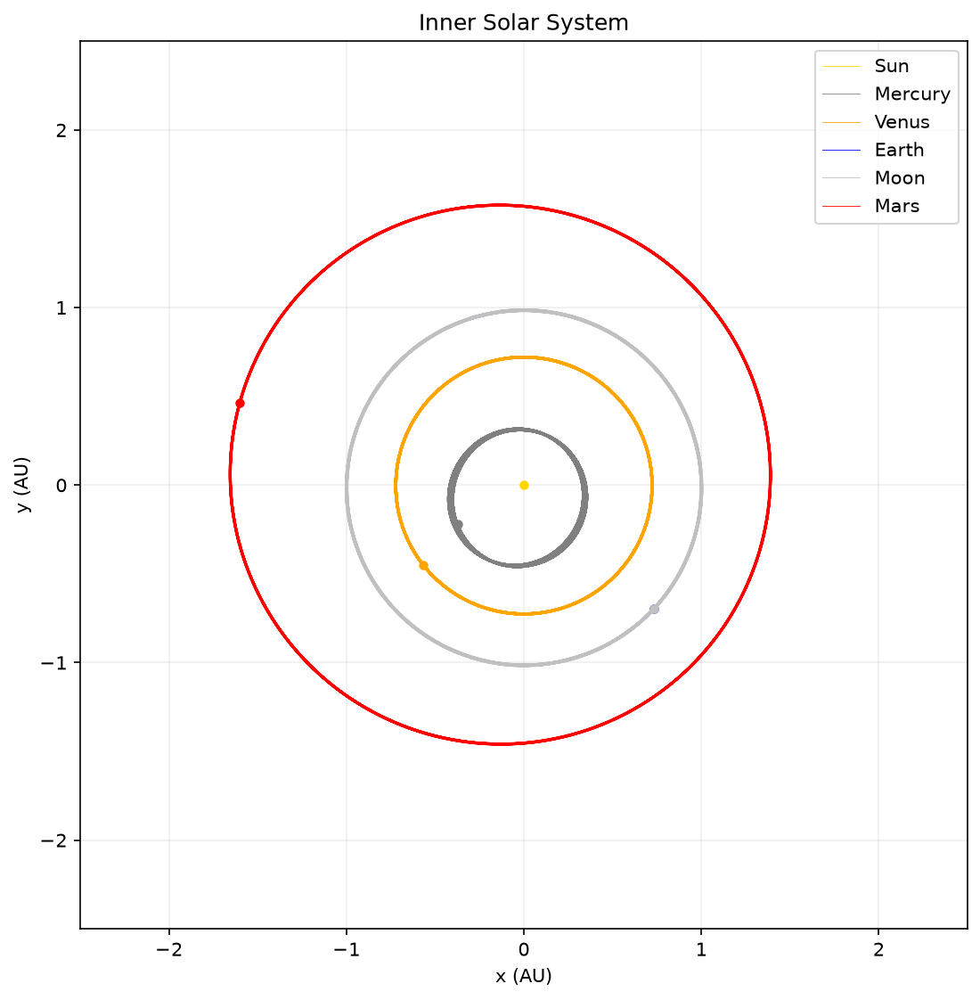
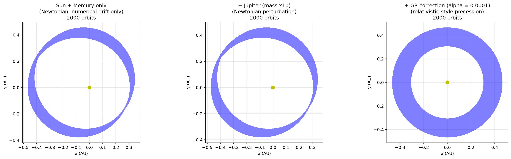

# N-Body Gravitational Dynamics with Verlet Integration

## Introduction

I built an N-body gravity simulator in Python/NumPy that integrates Newton’s law of gravity with the Verlet method and then tests how well it holds up. I started with a two-body orbit to check energy conservation and time reversibility, then used initial conditions from NASA’s JPL Horizons system to integrate the Solar System (all eight planets, the Moon, and Pluto) for 38.3 years. The energy error stays bounded and shrinks as Δt², dropping by about a factor of 1000 when the time step is 32× smaller; the method is effectively time-reversible, returning to its starting point within ~10⁻¹¹ AU after 50 orbits forward and back; and the Sun drifts up to 1.79 solar radii from its starting position as it orbits the Solar System’s center of mass, primarily driven by Jupiter’s gravitational influence

## Physics and method

**Gravity.** Each body feels the Newtonian pull of every other body:


```math
\mathbf{a}_i = G \sum_{j \neq i} m_j \frac{\mathbf{r}_j - \mathbf{r}_i}{\lvert \mathbf{r}_j - \mathbf{r}_i \rvert^3}
```


I loop over the N(N−1)/2 unique pairs and use Newton's third law to apply each force to both bodies at once, which cuts the work in half.

**Verlet integration.** Since gravity depends only on position, I use position Verlet, which steps forward using the current and previous positions:


```math
\mathbf{r}_{n+1} = 2\mathbf{r}_n - \mathbf{r}_{n-1} + \mathbf{a}_n \Delta t^2
```


Verlet isn't self-starting, so the first step uses a Taylor expansion with the initial velocity. I chose Verlet over RK4 for two reasons: it needs only one force calculation per step instead of four, and it's symplectic and time-reversible, so the energy error oscillates within a bound instead of drifting over long runs.

**Units.** I work in computational units where lengths are in AU, masses are in solar masses, and one time unit is 1 year / 2π. That makes G = 1 and puts Earth's orbital period at exactly 2π. JPL Horizons velocities (AU/day) are converted by multiplying by 365.25 / 2π, and I subtract the center-of-mass velocity so the system doesn't drift.

**Velocities and energy.** Verlet never tracks velocity directly, so I recover it afterward from the saved positions using second-order central differences (one-sided stencils at the endpoints). Kinetic and potential energy come from those velocities and positions. I leave out the first and last few steps when measuring energy error, because the one-sided endpoint stencils are less accurate.

**Reversing time.** Instead of estimating velocities and flipping their sign, I reverse the run by swapping the last two saved positions and integrating forward again. Because Verlet is built only from positions, this is an exact reversal of the algorithm, so any mismatch on return comes from floating-point roundoff, not the method.


## Results

### 1. Energy conservation



For a two-body elliptical orbit (initial speed set to 80% of the circular value), kinetic and potential energy trade off out of phase while the total stays nearly constant. The energy error ΔE = E(t) − E(0) spikes periodically near perihelion, where velocity and acceleration are largest and the truncation error is highest, but it never drifts.



Across six step sizes (45 to 1440 steps per orbit), the error stays bounded and shrinks as Δt²: max |ΔE| drops from 9.2 × 10⁻⁸ to 1.0 × 10⁻¹⁰ when the step is 32× smaller. That's the long-term behavior expected from a symplectic integrator.

### 2. Time reversibility



After integrating 50 orbits forward and then reversing, the planet returns to its starting point within about 10⁻¹¹ AU for every step size. The error doesn't trend with Δt because it comes from floating-point roundoff, not from the method itself, so Verlet is effectively time-reversible and well suited to long simulations.

### 3. The Solar System from JPL Horizons



Starting from JPL Horizons positions and velocities, I integrated the Sun, eight planets, the Moon, and Pluto for 38.3 years. The wide spread of orbital scales shows the Solar System's layered structure: the inner planets complete many orbits while Neptune and Pluto cover only part of one.




The Sun doesn't sit still. Pulled mainly by Jupiter, it drifts up to 1.79 solar radii from its starting position as it orbits the Solar System's center of mass.

### 4. Mercury's perihelion precession (in progress)



I compared Mercury's orbit with the Sun alone, with a 10× heavier Jupiter added, and with a relativistic-style 1/r² correction. Both perturbations make the ellipse rotate into a rosette. I'm currently measuring how much precession the integrator itself introduces at this step size, so the physical effects can be separated from numerical error before I report rates.


## Figures


## Full Report

